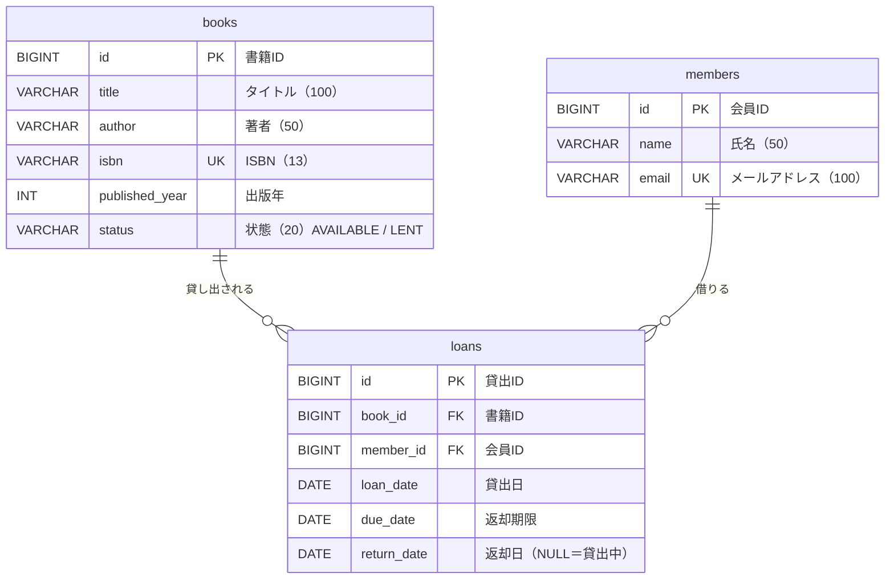

# 図書貸出管理アプリ ER図・テーブル定義書

データベース `library` には books・members・loans の3つのテーブルがあり、loans が書籍と会員をつなぎます。
定義の元は `sql/01_schema.sql` です。

## ER図

本1冊にも会員1人にも、貸出の記録が0件以上つながります。本と会員は直接はつながらず、必ず loans を通ります。

## テーブル一覧

| 論理名 | 物理名 | 役割 | 対応するJavaクラス | 初期データ |
| --- | --- | --- | --- | --- |
| 書籍 | books | 図書館が持っている本。1冊1行 | `entity/Book.java` | 8件 |
| 会員 | members | 本を借りる人 | `entity/Member.java` | 3件 |
| 貸出 | loans | 「誰がどの本をいつ借りたか」の記録。返却後も履歴として残る | `entity/Loan.java` | 3件 |

テーブルの文字コードはすべて utf8mb4、ストレージエンジンは InnoDB です。

## books（書籍）

| No | 論理名 | 物理名 | データ型 | NULL | キー | 初期値 | Javaフィールド | 説明 |
| --- | --- | --- | --- | --- | --- | --- | --- | --- |
| 1 | 書籍ID | id | BIGINT | 不可 | PK | 自動採番 | `id` (Long) | AUTO_INCREMENT |
| 2 | タイトル | title | VARCHAR(100) | 不可 | | | `title` (String) | |
| 3 | 著者 | author | VARCHAR(50) | 不可 | | | `author` (String) | |
| 4 | ISBN | isbn | VARCHAR(13) | 不可 | UK | | `isbn` (String) | 13桁の数字。重複不可 |
| 5 | 出版年 | published_year | INT | 可 | | | `publishedYear` (Integer) | 空欄可 |
| 6 | 状態 | status | VARCHAR(20) | 不可 | | 'AVAILABLE' | `status` (BookStatus) | AVAILABLE：貸出可 / LENT：貸出中 |

## members（会員）

| No | 論理名 | 物理名 | データ型 | NULL | キー | 初期値 | Javaフィールド | 説明 |
| --- | --- | --- | --- | --- | --- | --- | --- | --- |
| 1 | 会員ID | id | BIGINT | 不可 | PK | 自動採番 | `id` (Long) | AUTO_INCREMENT |
| 2 | 氏名 | name | VARCHAR(50) | 不可 | | | `name` (String) | |
| 3 | メールアドレス | email | VARCHAR(100) | 不可 | UK | | `email` (String) | 重複不可 |

## loans（貸出）

| No | 論理名 | 物理名 | データ型 | NULL | キー | 初期値 | Javaフィールド | 説明 |
| --- | --- | --- | --- | --- | --- | --- | --- | --- |
| 1 | 貸出ID | id | BIGINT | 不可 | PK | 自動採番 | `id` (Long) | AUTO_INCREMENT |
| 2 | 書籍ID | book_id | BIGINT | 不可 | FK | | `book` (Book) | books.id を参照 |
| 3 | 会員ID | member_id | BIGINT | 不可 | FK | | `member` (Member) | members.id を参照 |
| 4 | 貸出日 | loan_date | DATE | 不可 | | | `loanDate` (LocalDate) | |
| 5 | 返却期限 | due_date | DATE | 不可 | | | `dueDate` (LocalDate) | 貸出日の14日後 |
| 6 | 返却日 | return_date | DATE | 可 | | | `returnDate` (LocalDate) | NULL＝貸出中 |

Javaでは `book_id` を数値ではなく `Book` オブジェクトとして持ちます（`@ManyToOne` と `@JoinColumn(name = "book_id")`）。
`loan.getBook().getTitle()` のように、貸出から本の情報をたどれます。

## 制約と値の決まり

| 制約名 | 種類 | テーブル.列 | 意味 |
| --- | --- | --- | --- |
| uk_books_isbn | 一意 | books.isbn | 同じISBNの本は2冊登録できない |
| uk_members_email | 一意 | members.email | 同じメールアドレスの会員は登録できない |
| fk_loans_book | 外部キー | loans.book_id → books.id | 存在しない本は貸し出せない。貸出履歴がある本は削除できない |
| fk_loans_member | 外部キー | loans.member_id → members.id | 存在しない会員には貸し出せない |

- **books.status**：`AVAILABLE`（貸出可）か `LENT`（貸出中）のどちらか。Javaの `BookStatus` 列挙型の名前がそのまま文字列で入る（`@Enumerated(EnumType.STRING)`）
- **loans.return_date**：NULL なら貸出中、日付が入っていれば返却済み。「今借りている本」は `return_date IS NULL` で探す
- **延滞**：専用の列はない。`return_date IS NULL` かつ `due_date` が今日より前の行が延滞
- **1人3冊まで**：テーブルの制約ではなく、アプリの `LoanService` で確かめるルール
